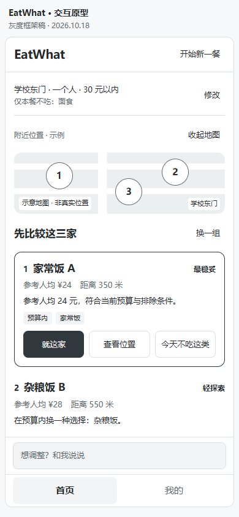
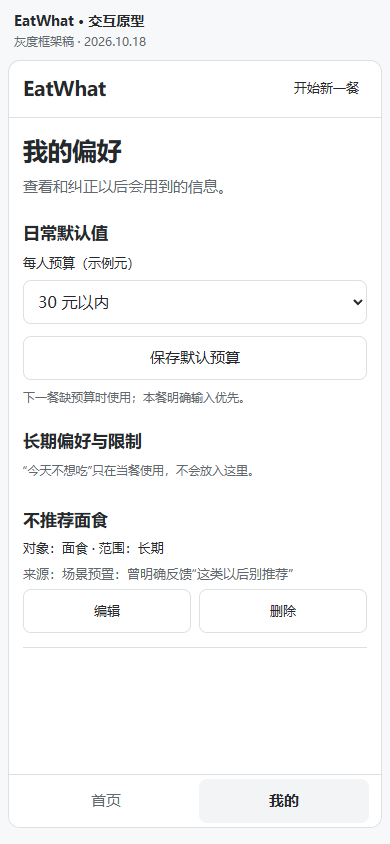

# EatWhat · 产品工作区

帮助用户根据当次想法、附近位置和个人偏好，决定这一顿吃什么。

我们正在完善**手机网页的产品方案**：首页用地图、推荐卡片和对话辅助选餐，个人页管理偏好。这个仓库由五人产品组协作，交付 PRD、业务规则、页面草图、视觉稿和可演示原型，供开发团队后续使用。

## 第一次进来，从这里开始

1. **先体验产品。** 按下方说明下载原型，走一遍首次选餐、当次反馈和偏好纠错。
2. **找到自己的任务。** 查看[任务看板](./协作区/任务看板.md)中的姓名与方向，再读[逐人分工说明](./协作区/产品组分工说明.md)和自己的模块。
3. **开始补稿。** 按[新成员引导](./协作区/新成员开始这里.md)完成需求、草图和行为例子；不必等其他模块交稿。

| 核心入口 | 用途 |
| --- | --- |
| [PRD 产品主稿](./PRD.md) | 看目标、范围、两页框架、共同规则和交接 |
| [任务看板](./协作区/任务看板.md) | 查负责人、任务编号、状态、时间与成果链接 |
| [产品组分工说明](./协作区/产品组分工说明.md) | 逐人看先读什么、具体补什么、画哪些状态、交什么 |
| [协作区目录](./协作区/README.md) | 找模板、决策、会议材料及 Git 协作说明 |

## 怎么看原型

**GitHub 文件页展示 HTML 源码，不能直接点击演示。** 登录有仓库权限的账号后：

1. 在仓库首页选择 **Code → Download ZIP**，也可[下载 main 完整目录](https://github.com/lennney/eatwhat/archive/refs/heads/main.zip)。
2. 解压整个压缩包，打开 `协作区/原型/index.html`；无需安装开发环境。已经 clone 的同学直接打开该文件。
3. 按[原型操作说明](./协作区/原型/README.md)走三条演示路径。电脑上可查看评审操作区，产品画面优先按手机尺寸设计。

当前灰度原型使用固定示例，未连接真实地图、AI 或存储，刷新会重置状态。它帮助讨论页面和操作，最终视觉由 E 细化，完整业务分支由 B/C/D 补充。

<details>
<summary>先看两页截图（2026-10-18 灰度样例）</summary>

| 首页：推荐与选定 | 个人页：偏好管理 |
| --- | --- |
|  |  |

截图用于快速了解框架，不是最终视觉稿；操作以本地原型及对应说明为准。

</details>

## 我负责哪一块

| 方向 | 自己维护的主稿 | 主要负责 |
| --- | --- | --- |
| A 产品统筹 | [PRD](./PRD.md) | 范围、两页框架、共同规则、跨模块取舍与分批整合 |
| B 输入与补问 | [B 模块](./协作区/模块/B-输入与补问.md) | 新用户引导、缺位置补问、默认值和修改条件 |
| C 推荐与选定 | [C 模块](./协作区/模块/C-推荐与选定.md) | 卡片信息与比较、换推荐、选定和地图关系 |
| D 反馈与偏好 | [D 模块](./协作区/模块/D-反馈与偏好.md) | 反馈对象与范围、个人页查看、编辑和删除偏好 |
| E 整体交互与视觉 | [E 模块](./协作区/模块/E-交互与用户验证.md) | 信息层级、配色字体、公共控件、两页视觉及状态规范 |

姓名、认领情况和实际时间只在任务看板维护。B/C/D/E 都参与产品判断；设计专业同学主责 E。每人每周按 4–6 小时统筹，首轮先交可讨论的粗稿，具体画面与预算见各模块。

**已有的共同起点：**PRD 框架、灰度两页、共同样例和填写示范。**接下来：**B/C/D 分别细化业务状态，E 同时提出首页视觉样稿；A 按收到的成果整合，后续由 A 与 AI 更新共享可点击原型。没有收到他人的细稿时，先用 PRD 第 7.1 节样例并标明假设。

## 做到什么程度，怎么交

每轮交四样：**需求说明、对应草图或设计稿、至少 3 条行为例子、待定问题及建议。** 首轮讲清一条主路径和关键分支即可；按自己的案例检查后交 A，不必等待互评。不会画图可以在截图上批注。

- **各自修改：**自己的模块，以及 `协作区/原型/模块草图/角色/` 下的图稿；在线设计稿把链接、版本和关键画面快照放回模块。
- **Git 交稿：**从最新 main 开自己的任务分支，通过 [Pull request](https://github.com/lennney/eatwhat/pulls) 交 A。main 由 A 统一整合；详细规则见[给 AI 的 Git 协作约定](./协作区/Git协作约定-给AI.md)。
- **不会 Git：**交带任务编号、版本日期的模块改稿与图稿给 A，由 A 汇总；产品产出要求相同。
- **异步配合：**交稿时附任务编号、完成内容、成果链接、未定问题和实际投入时间。A 更新共享看板；采用结论进入 PRD 或决策记录。

这个工作区只管理产品资料。算法实现、后端、真实地图接入和开发排期由开发团队另行处理；产品方案中的技术疑问可以列出，不阻止提交本轮粗稿。

## 可以直接给 AI 的开工提示

替换方括号里的内容；任务、图稿编号在看板和自己模块里找。

```text
我是 EatWhat 产品组的【B/C/D/E】，负责【任务编号】。
先读 AGENTS.md、README、协作区/Git协作约定-给AI.md、PRD 相关条目、我的模块和任务看板。
先检查实际目录、分支及已有改动，再按本模块“首轮必做”帮助我补稿。
本轮交付需求说明、对应草图、至少 3 条行为例子、待定问题及建议。
只改我的模块和自己的图稿；使用共同样例，不等其他人；新增取舍标为提案。
跨模块影响写清交 A，A 统一维护 PRD、看板、决策与共享原型。
沿用当前有效授权完成编辑、检查与 Git 交付，最后说明实际改动和提交状态。
```

更多资料见[协作区目录](./协作区/README.md)。仓库为团队私有空间，成员接入情况以任务看板为准。
